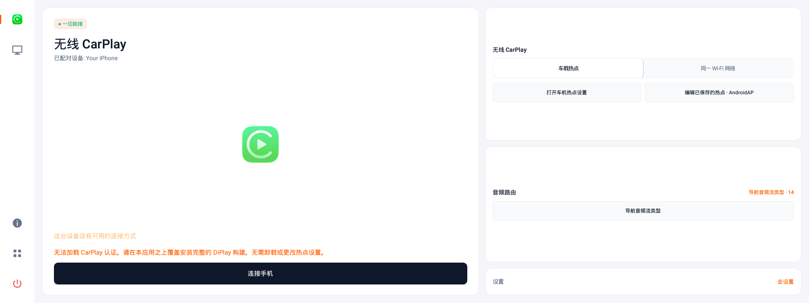
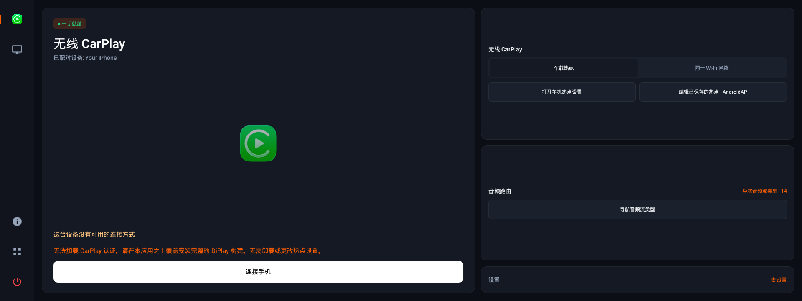
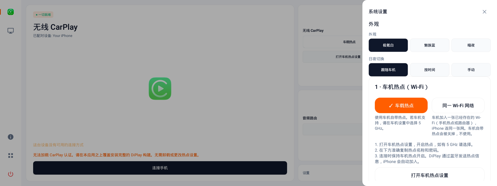
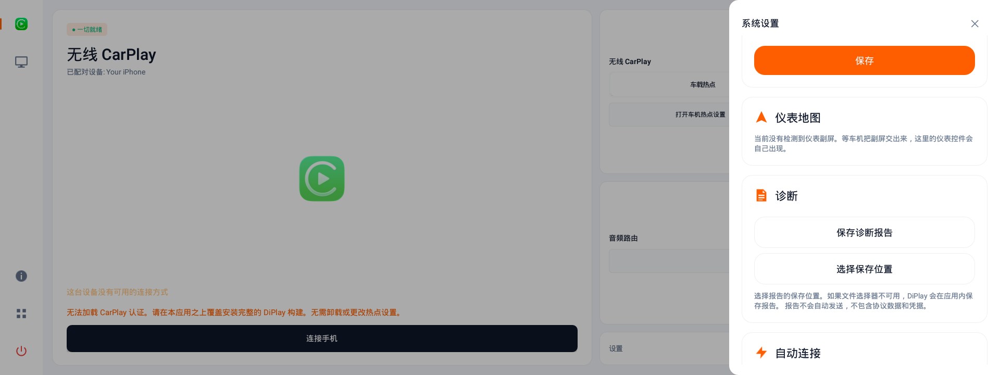
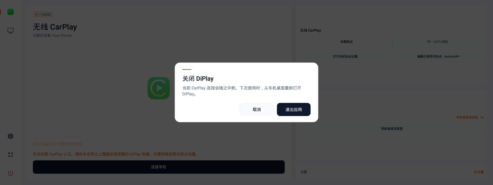

# DiPlay — Geely Xingrui E01

[中文（主）](README.md) · **English**

CarPlay for the **2021 Geely Xingrui (星瑞)** head unit: ECARX E01, MediaTek MT6735, GKUI 19, **Android 5.1 (API 22)**. Installed on the car. No jailbreak, no dongle.

Current version: **`0.4.5-geely`**. App id: `com.shihab.diplay`. Install `DiPlay-Legacy-Geely-V045.apk`.

Not Apple-certified, and not affiliated with Geely or ECARX. CarPlay is a trademark of Apple Inc.

## Screens

The cockpit is laid out for the 1920×720 panel: a Slim Dock on the left, the connection stage in the middle, wireless/audio quick cards on the right. Settings live in a half-screen drawer; four driving-time controls live in the three-finger bar.

| Day · Dawn white | Night |
|---|---|
|  |  |

| Settings drawer | Cluster map and diagnostics |
|---|---|
|  |  |

**Exit confirmation**



> Screenshots come from the AVD development build. It carries no accessory identity, so the stage shows “CarPlay authentication could not be loaded”; the release package includes the identity and normally does not show that line. The settings screenshot predates the skin rename, so its buttons still show the old names; the app uses Dawn white / Sky blue / Night.

## What it does

- **Wired CarPlay** over a USB data cable; it has shown a picture on the reference car.
- **Wireless · car hotspot (Recommended)**: the head unit makes the hotspot, the iPhone joins it, paired over Bluetooth. Direct peer connection, highest stability. DiPlay reads the saved hotspot credentials, using 5 GHz when available.
- **Wireless · same Wi-Fi (Alternative / supported)**: the head unit and iPhone join the same Wi-Fi (supports iPhone personal hotspot, Android phone hotspot, home router or portable Wi-Fi), paired over Bluetooth. 0.4.5 defaults to IPv6 link-local handshake to bypass IPv4 ARP delays, enabling instant connection on the car with in-memory address family caching (usable as an alternative, though overall stability is subject to external network interference and is not as solid as direct car hotspot).
- **Touch responsiveness**: dedicated `TouchDispatchQueue` merges high-frequency `MOVE` events with hardware timestamps, eliminating scroll lag and frame drops.
- **Steering wheel** previous/next works. There is no play/pause key — that position is the head unit's screen-mirroring button.
- **Three-finger quick bar** over the CarPlay picture: disconnect, navigation audio stream, day/night, exit.
- **Diagnostic report**: saved to a USB stick first, then Downloads/private storage. The official package never uploads on its own.

## Read this before installing

Wireless CarPlay uses the vendor Bluetooth already running on the head unit. To carry CarPlay's data path, DiPlay **replaces that Bluetooth process**.

- Does not write `/system`. **Reboot the head unit and the original process comes back.**
- No restore button in the app. Reboot to put it back immediately.
- **Opening DiPlay replaces it**, whether or not wireless is used; it stays until the next reboot.
- The car's own **calls and Bluetooth music** have been verified after process takeover and function normally; rebooting restores default state if needed.
- Unofficial change: outside warranty, may interfere with a later official OTA.

Use a cable to avoid all of that. **USB does not touch Bluetooth.**

Full risk note and disclaimer: [v0.4.3 release notes](docs/release-notes/v0.4.3-geely.md).

## Install

The head unit must allow APK installation.

Moving from upstream DiPlay, the signing key is different, so uninstall first. Uninstalling clears resolution, audio buffer, steering-wheel keys and saved Wi-Fi.

A later build of this fork installs over the previous one and keeps its settings.

```sh
adb uninstall com.shihab.diplay
adb install -r DiPlay-Legacy-Geely-V045.apk
```

Without ADB, copy the APK to a USB stick and install it from the head unit's file manager.

### Which package

Use `DiPlay-Legacy-Geely-V045.apk` for normal installation.

## After it opens

**Car hotspot (Recommended, most stable).** Turn on Bluetooth and Wi-Fi on the phone, pair it with the car, keep the car hotspot on, then tap **Connect phone**. DiPlay reads the saved hotspot name and password; 5 GHz is used when the radio allows it.

**Same Wi-Fi (Alternative / supported).** Connect both the head unit and the iPhone to the same Wi-Fi (e.g. iPhone personal hotspot, Android phone hotspot, home router or portable Wi-Fi). Turn on Bluetooth and Wi-Fi on the phone, pair with the car, then tap **Connect phone**. 0.4.5 connects via IPv6 link-local instantly; if the head unit has not saved the Wi-Fi password, enter it once in the settings drawer. Note: same Wi-Fi is an alternative mode; its stability depends on channel congestion and routing, and is not as solid as direct car hotspot.

**Wired.** Tap **Connect with USB**, use a data cable in a data port. On the reference car an iPhone 17 Pro Max draws more current than the port supplies and reconnects; a powered hub avoids that.

**Three-finger swipe** on the CarPlay picture drops the quick bar. Audio stream changes take effect on the next connection. Exit asks twice (3 s window). The bar hides after 6 s (20 s while the channel strip is open), and a tap outside closes it.

**Settings.** The gear opens the half-screen drawer: wireless/wired, display and audio (music buffer: 300 / 500 / 1000 ms, **500 ms strongly recommended on Geely E01** to avoid driver write stalls and stuttering/rewinding), and system. Resolution, frame rate, icon size and music buffer need **Apply and reconnect** during a session; connection settings end the session and return home rather than reconnecting on their own.

**Appearance.** Dawn white (default), Sky blue, night. Day/night follows the car, the clock (18:00–06:00), or a manual choice.

## What has actually been tried

| Item | State |
|---|---|
| Steering wheel previous/next | ✅ Verified on the reference car |
| Wired USB picture | ✅ Shown on the reference car; power-related reconnects |
| Built-in Bluetooth wireless | ✅ Verified on reference car, connection stable |
| Same Wi-Fi mode | ✅ Verified on reference car (0.4.4 introduced, 0.4.5 IPv6 instant connect) |
| Touch responsiveness & dispatch | ✅ Dedicated TouchDispatchQueue merges events, verified smooth on car |
| Cockpit UI / drawer / quick bar | ✅ Verified on reference car at 1920×720, verified for long drives |
| USB diagnostic export | ✅ Verified one-click write to physical USB stick on the car |
| Calls / Bluetooth music after wireless takeover | ✅ Verified on car, working normally |
| Incoming calls, Siri, long trips, future iOS | ❌ Needs wider testing |

Reference car: software **5068** (factory batch 5066), build `SWFS11G0706H5181.00600`. Check **Settings → About the smart platform → Version**. A different version can still be installed, but the risk may differ.

**Memory is the binding constraint:** free memory is often only **26–33 MB**. The cockpit is kept light and updated in place rather than rebuilt every second. The build also runs on **Android 4.4** head units; the car used is 5.1. Wireless offers both "Same Wi-Fi" and "Car hotspot" modes, both verified on the reference car.

## Origin

A Geely fork of [programmerguohuajing/DiPlay-Legacy-Android](https://github.com/programmerguohuajing/DiPlay-Legacy-Android), which forks [shihabal3amri/DiPlay](https://github.com/shihabal3amri/DiPlay). Base: upstream **v0.2.7**. BYD cluster, HUD and battery code has been removed.

The receiver is based on [xcertplay](https://github.com/shilapi/xcertplay), GPL-3.0. The home and settings UI adapt [DiAuto](https://github.com/shihabal3amri/DiAuto), AGPL-3.0. Licences are in `docs/licenses`; keep the notices when redistributing a modified build.

The repository does not contain the signing key. The release APK carries an experimental accessory identity taken from public Carlinkit firmware; it is not an MFi identity issued for DiPlay, and future iOS acceptance is not guaranteed. Details: [build notes](docs/BUILD.md), [credits](docs/THIRD_PARTY_NOTICES.md).

## More

- [What changed after 4.1 — additions, improvements, optimizations, fixes](CHANGELOG-4.1-to-HEAD.md)
- [Full changelog](CHANGELOG.md)
- [v0.4.5 release notes](docs/release-notes/v0.4.5-geely.md)
- [v0.4.4 release notes](docs/release-notes/v0.4.4-geely.md)
- [v0.4.3 release notes](docs/release-notes/v0.4.3-geely.md)
- [Build from source (developers)](docs/BUILD.md)
- [Install and connect](docs/INSTALL.md)
- [Compatibility](docs/COMPATIBILITY.md)
- [Privacy and diagnostic reports](docs/PRIVACY.md)
- [Credits and licences](docs/THIRD_PARTY_NOTICES.md)
