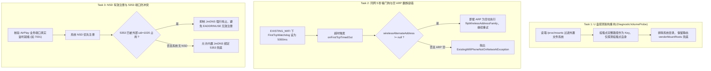

# 同网极速自愈、NSD 端口防冲突与 U 盘日志导出修复 Implementation Plan

> **For agentic workers:** REQUIRED SUB-SKILL: Use superpowers:subagent-driven-development (recommended) or superpowers:executing-plans to implement this plan task-by-task. Steps use checkbox (`- [ ]`) syntax for tracking.

**Goal:** 
1. 解决吉利 E01 车机上同网 Wi-Fi 掉线重连慢的问题：同网模式（`EXISTING_WIFI`）首次 TCP 等待窗口收紧至 5 秒快速自愈；修复空 ARP 误判逻辑，存在备用地址族时不阻断重试并顺利翻族。
2. 优化 NSD 与广播注册流程：在广播前核验 AirPlay 业务端口实际就绪状态，并在 UDP 5353 已被外部系统进程（如 `uid=1020` 系统 `mdnsd`）持有时抑制内置 JmDNS 强行抢占绑定，杜绝 `EADDRINUSE` 冲突与无效广播。
3. 彻底修复 U 盘日志保存失败问题：以 `/proc/mounts` 为第一数据源，以挂载点自身作为独立卷探测（不扫描拆分子目录），保留完整挂载路径防撞名，静态路径兜底，保持 `sync()` 物理刷盘。

---

## 事实核实与边界对齐 (Fact Alignment)

1. **重连按钮与控制器生命周期**：
   - 手动重连按钮位于 `CarPlayHostActivity.retryConnectionNow()`，不涉及 `DiPlayActivity`。
   - `CarPlayController` 无需增加新的 `abort()` 或 `forceResetSession()`。点重连时，`restartCarPlay()` 已经会执行 `oldController?.close()` 并通过 `awaitClosed(CONTROLLER_CLOSE_TIMEOUT_MILLIS)` 等待其释放完毕再启动下一轮。
2. **掉线期间的真实媒体与网络状态**：
   - 17:52:46 事件通道超时后，`AirPlaySession.close()` 已经执行。同一秒视频已标记 `packets=0 ended=true`，直到 17:53:57 新画面建立才有下一行视频。
   - 等待期间整机 UDP 仅为每 10 秒几 KB，手机并未推流。手机走完蓝牙 iAP2 握手后，仅因当前首选地址在局域网内单播不通而未连 7001。
3. **地址族选择与 17:39 成功记录**：
   - 17:39 成功建连时，车机发布的正是 `family=IPv4 preference=default`，0x4301 同时携带 IPv4 和 IPv6 两个地址，手机约 1.3 秒后自主从 IPv6 连上 7001。
   - **IPv4 在前不会阻断同网连接，无需也不应强制锁定 IPv6 优先**。
   - 17:53:15 手动重连慢的原因是：旧会话已等待 25 秒，手动点击重连关掉旧会话并重置了 30 秒倒计时，导致车主重新硬等了整整 30 秒（17:53:16 -> 17:53:46）。因此核心解法是**同网模式超时缩短至 5 秒**。
4. **mDNS / NSD 与 5353 状态**：
   - E01 系统原生运行 `/system/bin/mdnsd`（`uid=1020`），占用 UDP 5353。系统 NSD 注册成功（`mdnsFamilies=nsd`），无 `EADDRINUSE`。
   - 绝不绕过 NSD 去抢占 5353。当 5353 被外部占用时，内置 JmDNS 不再盲目尝试绑定。

---

## Architecture & Core Decisions



---

## Global Constraints

- **最低 API 支持**：minSdk 19，E01 为 API 22。不可使用 Android 6.0+（API 23+）公共 API。
- **端口真凭实据**：广播必须反映底层真实绑定的端口，套接字占用基于 `/proc/net/{udp,tcp}` 真实状态判定。
- **主线程零阻塞**：所有磁盘与网络探测、Socket 状态查询必须在工作线程执行。

---

### Task 1: 修复 U 盘探测根卷架构 (`DiagnosticVolumeProbe`)

**Files:**
- Modify: `common/src/main/java/com/shilapi/xcertplay/DiagnosticVolumeProbe.kt`
- Test: `common/src/test/java/com/shilapi/xcertplay/DiagnosticVolumeProbeTest.kt`

**Interfaces:**
- Consumes: `DiagnosticVolumeProbe.probe(context: Context, extraMountPaths: Collection<String>): ProbeSummary`
- Produces: 优先从 `/proc/mounts` 解析的外置卷，挂载点自身作为唯一探测根，杜绝子目录二次卷爆炸。

- [ ] **Step 1: 编写新增测试用例**
  在 `DiagnosticVolumeProbeTest.kt` 中添加单测：
  - 测试 `/proc/mounts` 内容解析（过滤系统虚拟文件系统，提取 vfat/exfat/fuse/ntfs 挂载点）；
  - 测试以完整路径作为键，挂载点自身被探测，而不把挂载点子目录拆分成伪独立卷；
  - 测试主存储 `/storage/emulated/0` 被正确排除。
- [ ] **Step 2: 运行测试并验证失败**
  运行 `./gradlew :common:testDebugUnitTest --tests com.shilapi.xcertplay.DiagnosticVolumeProbeTest`。
- [ ] **Step 3: 重构 `DiagnosticVolumeProbe.kt` 探测逻辑**
  1. 增加 `/proc/mounts` 解析器，提取合法外置存储挂载点（过滤类型如 vfat, exfat, fuse, ntfs, ext4，排除 `/storage/emulated`、`/system`、`/data` 等内部路径）。
  2. 候选列表以 `mountPoint.absolutePath` 为 Key，每个挂载点仅自身进行可写性与应用目录探测（检查根目录测试文件与 `<mount>/Android/data/<pkg>/files`）。
  3. 保留静态路径（`/storage/usbotg`、`/storage/sdcard1` 等）作为 `/proc/mounts` 读取失败时的兜底降级源。
- [ ] **Step 4: 运行测试确认通过**
  运行 `./gradlew :common:testDebugUnitTest --tests com.shilapi.xcertplay.DiagnosticVolumeProbeTest`。
- [ ] **Step 5: 提交更改**
  `git commit -m "fix(diag): parse mounts from /proc/mounts and probe mount points as discrete volumes"`

---

### Task 2: 同网 5 秒看门狗与空 ARP 翻族容错 (`CarPlayController` & `WirelessStartupPolicy`)

**Files:**
- Modify: `shared/src/main/java/com/shilapi/xcertplay/network/WirelessStartupPolicy.kt`
- Modify: `shared/src/main/java/com/shilapi/xcertplay/orchestration/CarPlayController.kt`
- Test: `shared/src/test/java/com/shilapi/xcertplay/orchestration/FirstTcpWatchdogTest.kt`

**Interfaces:**
- Consumes: `WirelessStartupPolicy.FIRST_TCP_EXISTING_WIFI_MILLIS`, `CarPlayController.onFirstTcpTimedOut()`
- Produces: 同网模式 5 秒看门狗超时；有备用地址族时空 ARP 依然翻族重试。

- [ ] **Step 1: 编写单测**
  - 在 `FirstTcpWatchdogTest.kt` 中：测试支持传入自定义超时（5,000ms），并在 5 秒到期时按期触发 `expire()`。
  - 在 `FirstTcpWatchdogTest.kt` 中：测试默认超时仍为 30,000ms，差异化超时配置生效。
- [ ] **Step 2: 运行测试并验证失败**
  运行 `./gradlew :shared:testDebugUnitTest --tests com.shilapi.xcertplay.orchestration.FirstTcpWatchdogTest`。
- [ ] **Step 3: 实现差异化超时与空 ARP 翻族逻辑**
  1. 在 `WirelessStartupPolicy` 中定义：
     ```kotlin
     const val FIRST_TCP_EXISTING_WIFI_MILLIS = 5_000L
     ```
  2. 在 `CarPlayController.kt` 初始化 `FirstTcpWatchdog` 时，根据 `hotspotInfo.backend` 是否为 `EXISTING_WIFI` 动态传入超时（同网模式 5,000ms，车载热点保持 30,000ms）。
  3. 在 `CarPlayController.onFirstTcpTimedOut()` 中：
     ```kotlin
     val peers = ipv4PeersOnAccessPoint()
     val hasAlternate = wirelessAlternateAddress != null
     if (peers != null && peers.isEmpty() && !hasAlternate) {
         // 仅在完全没有备选协议簇时，才判定为手机未入网
         closeWirelessStack()
         val ex = ...
         fail(ex)
         return@Thread
     }
     flipWirelessAddressFamily()
     closeWirelessStack()
     fail(FirstTcpTimeoutException(...))
     ```
- [ ] **Step 4: 运行全部相关单测**
  运行 `./gradlew :shared:testDebugUnitTest --tests com.shilapi.xcertplay.orchestration.*`。
- [ ] **Step 5: 提交更改**
  `git commit -m "perf(wireless): 5s first-tcp timeout for existing wifi with empty-arp family flip"`

---

### Task 3: NSD 端口有效性校验与 5353 冲突判断 (`PortHolders` & `CarPlayBonjour`)

**Files:**
- Modify: `shared/src/main/java/com/shilapi/xcertplay/network/PortHolders.kt`
- Modify: `shared/src/main/java/com/shilapi/xcertplay/network/CarPlayBonjour.kt`
- Test: `shared/src/test/java/com/shilapi/xcertplay/network/PortHoldersTest.kt`
- Test: `shared/src/test/java/com/shilapi/xcertplay/network/CarPlayBonjourTest.kt`

**Interfaces:**
- Consumes: `PortHolders.isUdpPortHeld(port: Int)`, `CarPlayBonjour.publishAirPlay()`, `bundledMdnsAfterNsd()`
- Produces: 5353 被外部占用时抑制 JmDNS 强行绑定；校验广播业务端口有效性。

- [ ] **Step 1: 编写单测**
  - 在 `PortHoldersTest.kt` 中添加单测：测试 `PortHolders.isUdpPortHeld(5353)` 能正确从 `/proc/net/udp` 与 `udp6` 模拟文本中判断端口占用状态。
  - 在 `CarPlayBonjourTest.kt` 中添加单测：测试 `bundledMdnsAfterNsd(..., port5353Held = true)` 必定返回 `false`，确保在 5353 已被系统进程占用时绝不拉起 JmDNS。
- [ ] **Step 2: 运行测试并验证失败**
  运行 `./gradlew :shared:testDebugUnitTest --tests com.shilapi.xcertplay.network.PortHoldersTest`。
- [ ] **Step 3: 实现端口有效性与防冲突判断**
  1. 在 `PortHolders.kt` 中增加判断方法：
     ```kotlin
     fun isUdpPortHeld(port: Int): Boolean {
         val tables = listOf("/proc/net/udp", "/proc/net/udp6")
         return tables.any { path ->
             val text = runCatching { readBoundedDiagnosticFile(path, MAX_PROC_BYTES) }.getOrNull() ?: return@any false
             text.lineSequence().any { holderOf(it, port) != null }
         }
     }
     ```
  2. 在 `CarPlayBonjour.kt` 中：
     - 在 `bundledMdnsAfterNsd` 扩展参数 `port5353Held: Boolean = false`：
       ```kotlin
       internal fun bundledMdnsAfterNsd(
           result: NsdPublishResult,
           unregistered: Boolean,
           port5353Held: Boolean = false,
       ): Boolean = when {
           port5353Held -> false
           result == NsdPublishResult.REGISTERED -> false
           result == NsdPublishResult.REFUSED -> true
           result == NsdPublishResult.TIMED_OUT -> unregistered
           else -> false
       }
       ```
     - 在 `publishAirPlay()` 中传递 `PortHolders.isUdpPortHeld(MDNS_PORT)`。若 5353 已被占用，日志记录留存系统守护进程，抑制 `startInterfaceMdns()` 调用，彻底杜绝 `EADDRINUSE` 冲突。
     - 在 `registerAirPlay()` 中校验业务端口有效性（`require(config.port in 1..65535)`）。
- [ ] **Step 4: 运行全部相关单测**
  运行 `./gradlew :shared:testDebugUnitTest --tests com.shilapi.xcertplay.network.*`。
- [ ] **Step 5: 提交更改**
  `git commit -m "fix(bonjour): suppress bundled mDNS when 5353 is occupied and validate service port"`

---

### Task 4: 全量回归测试与发布产物核验

- [ ] **Step 1: 运行全量单元测试**
  运行 `./gradlew :common:testDebugUnitTest :shared:testDebugUnitTest`。
- [ ] **Step 2: 编译 local release 安装包**
  运行 `./gradlew :mobile:assembleStandaloneRelease -Pexperimental=on`。
- [ ] **Step 3: 校验 APK 产物**
  验证产物并将最终安装包复制到 `/Users/g/Downloads/xr/DiPlay-Legacy-Geely-V044-local.apk`。
