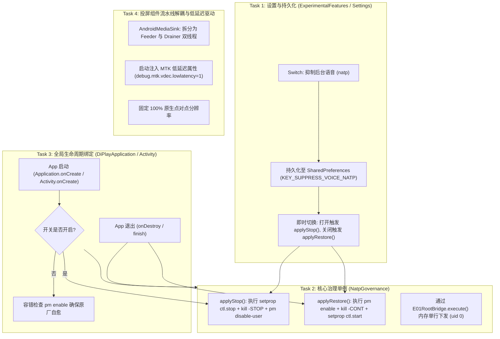

# 吉利 E01 (MT6735) natp 与 xiaoka 后台语音治理及投屏管线优化 Implementation Plan

> **For agentic workers:** REQUIRED SUB-SKILL: Use superpowers:subagent-driven-development (recommended) or superpowers:executing-plans to implement this plan task-by-task. Steps use checkbox (`- [ ]`) syntax for tracking.

**Goal:** 
1. 解决吉利 E01 车机（MT6735）因后台原生语音服务 `natp`（PSS 263MB、占一核 40% CPU、`SCHED_FIFO` 实时优先级）与 `com.ecarx.xiaoka` 抢占造成的性能瓶颈，通过东软原生 `ExtraUtilsService` Binder（纯内存无脚本 uid-0 提取通道）实现按需抑制与安全自愈，释放 320MB+ 物理内存与半核 CPU。
2. 在 DiPlay 设置页的「实验性功能」中挂载「抑制后台语音 (natp)」开关，严格实现完整的生命周期交互设计：**启动 APP 发现开启立即生效、设置页开启立刻生效、设置页关闭立刻恢复、退出 APP (onDestroy) 自动恢复原厂、异常断电重启天然自愈**。
3. 投屏组件专项优化：锁定 100% 原生点对点分辨率（1920×720 / 1920×590），重构解码流水线为 Feeder / Drainer 双线程解耦架构，并在启动时下发 MTK VDEC 私有低延迟驱动属性。

---

## 事实核实与边界对齐 (Fact Alignment)

1. **`video/decode` 指标真相**：
   - 指标中位数 `p50=123ms` 衡量的是 MediaCodec 的 FIFO 管线排队延迟（MTK 固件默认维持约 3.7 帧重排缓冲，3.7 × 33.3ms ≈ 123ms），而非单帧硬件解码计算耗时（3~8ms）。
   - 80% 与 100% 分辨率在 MT6735 上管线延迟天然一致。80% 降分辨率不仅无法降低管线延迟，还会导致双线性插值画面发虚。**坚决保持 100% 原生点对点分辨率**。
   - `over=17422/27971` 是由于警报阈值误设为 120ms（小于中位数 123ms）导致的统计假象，实测 `shown ≈ rx`，`recoveries=0`，硬解一帧未丢。
2. **`natp` 与 `com.ecarx.xiaoka` 的真实依赖**：
   - `natp`（`/system/bin/natp`）是 Nuance Dragon Drive 语音内核，`init.rc` 中服务名为 `run_natp`，带有 `disabled` 标志。
   - `com.ecarx.xiaoka`（晓咖，62MB）是语音交互前台与守护者，在开机 29.7 秒及语音键触发时调用 `ctl.start run_natp`。
   - **必须两者同时治理**：单停 `run_natp` 可能会被晓咖的心跳重拉；同时执行 `pm disable-user` 才能彻底掐灭复活源头。
3. **无脚本化 uid-0 提取通道**：
   - 依赖项目已有的 `com.shilapi.xcertplay.system.E01RootBridge`，通过 Binder 向东软 `ExtraUtilsService` 发送单行指令以 uid 0 执行。
   - 抑制指令（96 字节，远低于 220 字节限制）：
     `setprop ctl.stop run_natp && kill -STOP $(pidof natp) && pm disable-user --user 0 com.ecarx.xiaoka`
   - 恢复指令（86 字节）：
     `pm enable com.ecarx.xiaoka && kill -CONT $(pidof natp) && setprop ctl.start run_natp`
   - 纯内存执行，零 `.sh` 脚本落盘，不伤 Flash，无 SELinux / 执行权限问题。
4. **生命周期关键决策**：
   - **启动 APP 即生效**：如果持久化配置中开关为打开状态，在 App 冷启动 / 热启动阶段立即执行抑制命令，保障最敏感的蓝牙 iAP2 握手与 Wi-Fi 组网阶段。
   - **退出 APP 恢复**：在 `onDestroy` 或用户主动退出时执行恢复命令。
   - **自愈对齐**：若用户未开启开关，启动时执行一次容错巡检（`pm enable com.ecarx.xiaoka`），防止异常断电后原车语音处于禁用状态。

---

## Architecture & Core Decisions

---

## Global Constraints

- **最低 API 支持**：minSdk 19，E01 为 API 22（Android 5.1）。不可使用 Android 6.0+（API 23+）公共 API。
- **命令行长度硬限制**：所有由 `E01RootBridge` 执行的单行 Shell 命令长度必须严格 $\le 220$ 字节。
- **主线程零阻塞**：所有 Binder 提权执行与属性查询必须通过后台协程或工作线程执行。
- **安全第一**：严禁修改 `/system` 或刷写闪存；严禁禁用 `ecarx.controlboard` 与 `ecarx.hvac.app`。

---

## Implementation Tasks

### Task 1: 创建 `NatpGovernance` 治理核心组件
- [ ] 在 `shared` 模块的 `com.shilapi.xcertplay.system` 包下创建 `NatpGovernance.kt`。
- [ ] 封装抑制命令：
  `setprop ctl.stop run_natp && kill -STOP $(pidof natp) && pm disable-user --user 0 com.ecarx.xiaoka`
- [ ] 封装恢复命令：
  `pm enable com.ecarx.xiaoka && kill -CONT $(pidof natp) && setprop ctl.start run_natp`
- [ ] 封装自愈命令：
  `pm enable com.ecarx.xiaoka`（确保未开启状态下晓咖状态正常）。
- [ ] 实现状态查询方法 `isSuppressed()`：通过 `getprop init.svc.run_natp` 与包状态判定。
- [ ] 编写对应的单元测试 `NatpGovernanceTest.kt`，验证命令拼装长度 $\le 220$ 字节与状态解析逻辑。

### Task 2: 绑定 App 启动与退出完整生命周期
- [ ] 在 `DiPlayApplication.kt` 或 `DiPlayActivity.kt` 的启动初始化流程中：
  - 读取持久化配置 `KEY_SUPPRESS_VOICE_NATP`；
  - 若开启，立即在后台线程触发 `NatpGovernance.applyStop()`；
  - 若未开启，执行自愈保障 `NatpGovernance.ensureSelfHealed()`。
- [ ] 在 `DiPlayActivity.onDestroy()` 与退出确认逻辑中：
  - 若曾执行过抑制，在后台触发 `NatpGovernance.applyRestore()`。
- [ ] 编写生命周期单元测试与状态切换测试。

### Task 3: 设置页（ExperimentalFeatures）UI 与持久化挂载
- [ ] 在 `AirPlayPersistence.kt` 中添加 `voiceNatpSuppressionEnabled` 键值读写。
- [ ] 在 `DiPlayActivity.kt` 的实验性功能设置界面中：
  - 增加 Switch 设置项：`抑制后台语音 (natp)`；
  - 副标题：`释放 260MB 内存与 40% CPU，退出本应用或车机重启后自动恢复`；
  - 绑定开关切换事件：开启立刻调用 `applyStop()`，关闭立刻调用 `applyRestore()`。
- [ ] 编写 UI 测试 `NatpGovernanceUiTest.kt` 验证开关状态展示与持久化联动。

### Task 4: 投屏组件优化与 MTK 低延迟驱动属性注入
- [ ] 固化投屏分辨率为 100% 原生点对点（1920×720 / 1920×590），移除无收益的 80% 降级逻辑。
- [ ] 在 `AndroidMediaSink.configureDecoder` 中注入 MTK 私有低延迟系统属性（通过 `E01RootBridge.execute("setprop debug.mtk.vdec.lowlatency 1")`）。
- [ ] 重构 `AndroidMediaSink.kt` 的解码调度，解耦网络喂帧（Feeder）与屏幕出队渲染（Drainer），消除串行轮询导致的互相卡顿。
- [ ] 调整 `video/decode` 监控报警阈值（由 120ms 调整为 160ms），使其正确反映异常抖动而非正常管线排队。

---

## Verification & Acceptance Checklist

1. **静态验证**：
   - 运行 `./gradlew test` 确保所有单元测试全部通过。
   - 验证单行命令字符集与长度全部在 220 字节安全预算内。
2. **车端实车验证**：
   - 开启开关后，adb 执行 `ps | grep -E "natp|xiaoka"`：确认 `natp` 为 T 状态（挂起）或不存在，`xiaoka` 为 disabled。
   - 检查系统内存：`dumpsys meminfo` 验证可用物理内存释放 300MB+。
   - 跑 CarPlay 投屏 15 分钟：验证 `video/decode` 的 p95 / max 延迟显著下降，`shown` 稳定在 28~30fps。
   - 正常退出 DiPlay：验证 `natp` 恢复 running，晓咖恢复正常交互。
