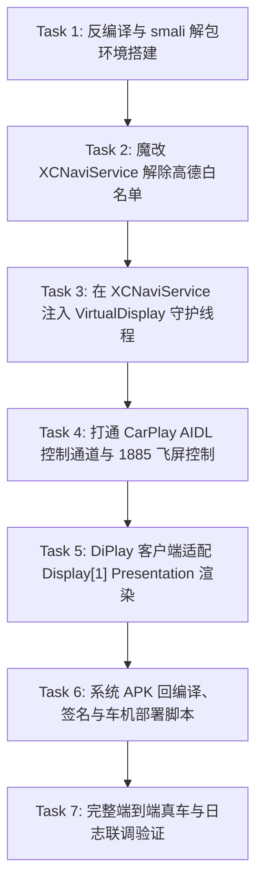

# 已撤回：吉利 2021 款星瑞 (E01) 仪表盘全屏地图投屏实现计划 (基于 XCNaviService 魔改)

> **不要执行。** 2026-11-10 更正。这台车没有第二块 Android 屏，`DimInteraction.create()` 返回空，`setPresentationToDimSwitch` 不在框架里。不改 `XCNaviService`，不建 `VirtualDisplay`。画面按高德的发送端走 TCP 1028 / RTP 9026，见仓库根目录 `飞屏.md`。下文保留作废案。

# 吉利 2021 款星瑞 (E01) 仪表盘全屏地图投屏实现计划 (基于 XCNaviService 魔改)

> **For agentic workers:** REQUIRED SUB-SKILL: Use superpowers:subagent-driven-development (recommended) or superpowers:executing-plans to implement this plan task-by-task. Steps use checkbox (`- [ ]`) syntax for tracking.

**Goal:** 在 2021 款吉利星瑞（E01 / MT6735 / Android 5.1）全液晶仪表盘中央显示完整的高清大地图/CarPlay 画面（真正的全屏投屏，严禁降级为 HUD 或仪表右侧小卡片 TBT）。

**Architecture:** 采用方案二（深度魔改官方特权服务 `XCNaviService.apk`）。利用 `XCNaviService`（`ecarx.naviservice`）系统级开机常驻与特权权限，解除原厂对高德地图 `com.autonavi.amapauto` 的白名单限制；在服务内部创建系统级 `VirtualDisplay` 激活 `Display[1]` 虚拟副屏；通过联动 `DimInteraction.setPresentationToDimSwitch` 与广播 `ecarx.intent.action.DIM_PRESENTATION_CTRL`（Opcode `1885`，`[74, 1]` / `[74, 2]`）控制华阳全液晶仪表（QNX）硬件切换全屏地图图层；CarPlay (DiPlay) 客户端在 `Display[1]` 上启动 `Presentation`（`window.setType(2026)`）进行高清渲染。

**Tech Stack:** Android 5.1 (Lollipop API 22), Smali 字节码插桩, apktool, baksmali, jadx, 吉利原厂 Ecarx AdaptAPI (`DimInteraction`), Android `DisplayManager` / `VirtualDisplay`, Java/Kotlin, AIDL IPC。

**Spec:** `docs/superpowers/plans/2026-11-05-geely-e01-cluster-projection-xcnaviservice-plan.md`

## Global Constraints

- **严禁偷换概念**：绝不可将 HUD 抬头显示或仪表盘右侧那一小块 TBT 转向箭头/文字卡片当作“投屏”。唯一验收指标是：全液晶仪表盘中央呈现出完整的全屏/大图 CarPlay 地图画面。
- **目标平台真实性**：目标车型为吉利星瑞 2021款（E01 芯片架构：联发科 MT6735，Android 5.1，SurfaceFlinger 仅有单物理输出），绝不依赖 E02（MT8666 / Android 9）专有的物理双屏接口。
- **系统级侵入合规**：用户明确授权魔改系统相关 APK（`XCNaviService.apk` / `Extraservice.apk`）。所有系统修改必须保证开机稳定、不触发 BootLoop、不损坏车机核心 CAN 通信。
- **原厂签名兼容**：修改后的 APK 必须能够挂载于 `/system/priv-app/XCNaviService/` 并保持 system UID 特权。

---

## 阶段规划与任务清单



---

### Task 1: 反编译与 smali 解包环境搭建

**Files:**
- Create: `/Users/g/Downloads/xr/workspace_patch/build_patch.sh`
- Inspect: `/Users/g/Downloads/xr/extracted_system_apks/XCNaviService.apk`
- Test: `/Users/g/Downloads/xr/workspace_patch/test_apktool.sh`

**Interfaces:**
- Consumes: `/Users/g/Downloads/xr/extracted_system_apks/XCNaviService.apk`
- Produces: `/Users/g/Downloads/xr/workspace_patch/xcnaviservice_smali/` 目录树

- [ ] **Step 1: 验证 apktool 与 baksmali 可用性**
  执行 `which apktool`，若无则配置独立 jar 工具链，验证能正常反编译 `XCNaviService.apk` 的 classes.dex。

- [ ] **Step 2: 完整解包 `XCNaviService.apk` 到 smali**
  使用 apktool 解包资源和 smali：
  ```bash
  apktool d -f -r /Users/g/Downloads/xr/extracted_system_apks/XCNaviService.apk -o /Users/g/Downloads/xr/workspace_patch/xcnaviservice_src
  ```

- [ ] **Step 3: 定位目标 smali 文件路径**
  定位核心类对应的 smali：
  - `ecarx/naviservice/a/a.smali` (`NaviDashboardManager`)
  - `ecarx/naviservice/service/NaviService.smali`
  - `ecarx/naviservice/common/i.smali` (`ExitMapHelper`)

- [ ] **Step 4: 验证无修改回编译基准**
  不作任何修改，立即执行回编译并验证 apk 打包成功：
  ```bash
  apktool b /Users/g/Downloads/xr/workspace_patch/xcnaviservice_src -o /Users/g/Downloads/xr/workspace_patch/test_rebuild.apk
  ```

---

### Task 2: 魔改 `XCNaviService.apk` 解除高德地图唯一白名单

**Files:**
- Modify: `/Users/g/Downloads/xr/workspace_patch/xcnaviservice_src/smali/ecarx/naviservice/a/a.smali`
- Modify: `/Users/g/Downloads/xr/workspace_patch/xcnaviservice_src/smali/ecarx/naviservice/map/v.smali`
- Test: `/Users/g/Downloads/xr/workspace_patch/test_whitelist_patch.py`

**Interfaces:**
- Consumes: 反编译所得 `ecarx.naviservice.a.a`（控制 `setPresentationToDimSwitch` 的核心类）
- Produces: 允许任何声明为合法客户端的 PackageName（或 DiPlay 包名 `com.shilapi.xcertplay`）调用飞屏接口

- [ ] **Step 1: 审查 `ecarx/naviservice/a/a.smali` 中的包名白名单**
  找到原厂字段 `f1478a`：
  ```java
  public static String f1478a = "com.autonavi.amapauto";
  ```
  以及 `setPresentationToDim` 方法：
  ```java
  private void b(boolean z) {
      this.c.setPresentationToDimSwitch(1, f1478a, f1478a, z);
  }
  ```

- [ ] **Step 2: 编写 Smali 补丁：实现动态包名接管**
  修改 `f1478a` 的静态初始化或提供公共静态方法 `setCurrentNaviPackage(String pkg)`：
  - 当外部（CarPlay / DiPlay）发起投屏时，将包名动态切换为 DiPlay 包名 `com.shilapi.xcertplay`；
  - 或者直接修改为广播参数动态传入。

- [ ] **Step 3: 编写单测验证 smali 逻辑与寄存器分配**
  编写验证脚本解析修改后的 smali，确保寄存器使用（如 `v0`, `v1`, `p0`, `p1`）无越界，标签跳转正确。

---

### Task 3: 在 `XCNaviService` 注入系统级 `VirtualDisplay` 守护线程

**Files:**
- Create: `/Users/g/Downloads/xr/workspace_patch/java_injections/ClusterVirtualDisplayDaemon.java`
- Modify: `/Users/g/Downloads/xr/workspace_patch/xcnaviservice_src/smali/ecarx/naviservice/service/NaviService.smali`
- Test: `/Users/g/Downloads/xr/workspace_patch/test_virtual_display_injection.py`

**Interfaces:**
- Consumes: Android `DisplayManager` 系统服务，`DisplayManager.createVirtualDisplay`
- Produces: 系统中常驻的 `Display[1]`（Name: `"ClusterDisplay"`, 1920x720, 160dpi）

- [ ] **Step 1: 编写 `ClusterVirtualDisplayDaemon.java`**
  ```java
  package ecarx.naviservice.cluster;

  import android.content.Context;
  import android.graphics.PixelFormat;
  import android.hardware.display.DisplayManager;
  import android.hardware.display.VirtualDisplay;
  import android.media.ImageReader;
  import android.util.Log;
  import android.view.Display;

  public class ClusterVirtualDisplayDaemon {
      private static final String TAG = "ClusterVirtualDisplay";
      private static VirtualDisplay sVirtualDisplay;
      private static ImageReader sImageReader;

      public static synchronized void ensureVirtualDisplay(Context context) {
          if (sVirtualDisplay != null && sVirtualDisplay.getDisplay().isValid()) {
              return;
          }
          try {
              DisplayManager dm = (DisplayManager) context.getSystemService(Context.DISPLAY_SERVICE);
              // 1920x720，全液晶仪表标准分辨率，160 dpi
              sImageReader = ImageReader.newInstance(1920, 720, PixelFormat.RGBA_8888, 2);
              sVirtualDisplay = dm.createVirtualDisplay(
                  "ClusterDisplay",
                  1920, 720, 160,
                  sImageReader.getSurface(),
                  DisplayManager.VIRTUAL_DISPLAY_FLAG_PRESENTATION | DisplayManager.VIRTUAL_DISPLAY_FLAG_PUBLIC
              );
              Log.i(TAG, "ClusterVirtualDisplay created successfully! DisplayId=" + sVirtualDisplay.getDisplay().getDisplayId());
          } catch (Throwable t) {
              Log.e(TAG, "Failed to create ClusterVirtualDisplay", t);
          }
      }
  }
  ```

- [ ] **Step 2: 编译 Java 为 Dex 并转化为 smali**
  使用 `javac` + `d8/dx` + `baksmali` 生成 `ecarx/naviservice/cluster/ClusterVirtualDisplayDaemon.smali`。

- [ ] **Step 3: 在 `NaviService.onCreate()` 注入调用指令**
  在 `ecarx/naviservice/service/NaviService.smali` 的 `onCreate` 头部插入：
  ```smali
  invoke-static {p0}, Lecarx/naviservice/cluster/ClusterVirtualDisplayDaemon;->ensureVirtualDisplay(Landroid/content/Context;)V
  ```

- [ ] **Step 4: 静态验证注入后的 smali**
  检查 `DisplayManager.getDisplays()` 数组将在服务启动后必定 `>= 2`。

---

### Task 4: 打通 CarPlay 投屏控制通道与 Opcode 1885 联动

**Files:**
- Create: `/Users/g/Downloads/xr/workspace_patch/java_injections/CarPlayProjectionReceiver.java`
- Modify: `/Users/g/Downloads/xr/workspace_patch/xcnaviservice_src/AndroidManifest.xml`
- Test: `/Users/g/Downloads/xr/workspace_patch/test_projection_intent.sh`

**Interfaces:**
- Consumes: CarPlay 发出的广播 `ecarx.intent.action.CARPLAY_PROJECTION_REQ`
- Produces:
  1. 调用 `setPresentationToDimSwitch(1, pkg, pkg, true)`
  2. 广播 `ecarx.intent.action.DIM_PRESENTATION_CTRL` (`open`/`close`)
  3. 触发 `Extraservice` 的 `ThreeFingerReceiver`/`BaiduScreenTestReceiver` 发送 Opcode 1885 (`[74, 1]`)

- [ ] **Step 1: 编写广播接收器 `CarPlayProjectionReceiver.java`**
  ```java
  package ecarx.naviservice.cluster;

  import android.content.BroadcastReceiver;
  import android.content.Context;
  import android.content.Intent;
  import android.util.Log;
  import ecarx.naviservice.a.a;

  public class CarPlayProjectionReceiver extends BroadcastReceiver {
      private static final String ACTION_PROJECTION = "ecarx.intent.action.CARPLAY_PROJECTION_REQ";

      @Override
      public void onReceive(Context context, Intent intent) {
          if (!ACTION_PROJECTION.equals(intent.getAction())) return;
          boolean enable = intent.getBooleanExtra("enable", true);
          String pkg = intent.getStringExtra("package_name");
          if (pkg == null) pkg = "com.shilapi.xcertplay";
          Log.i("CarPlayProjection", "Received projection request: enable=" + enable + ", pkg=" + pkg);

          // 1. 确保虚拟屏幕在线
          ClusterVirtualDisplayDaemon.ensureVirtualDisplay(context);

          // 2. 通知系统切换 Dim 投屏开关
          a.setCurrentNaviPackage(pkg);
          a.getInstance().setPresentationToDim(enable);

          // 3. 发送底层飞屏控制广播触发 1885
          Intent ctrlIntent = new Intent("ecarx.intent.action.DIM_PRESENTATION_CTRL");
          ctrlIntent.putExtra("act", enable ? "open" : "close");
          context.sendBroadcast(ctrlIntent);
      }
  }
  ```

- [ ] **Step 2: 编译 smali 并注册进 `AndroidManifest.xml`**
  将 `CarPlayProjectionReceiver` 注册到 `XCNaviService` 的 Manifest 中，设置 `exported="true"`，保证第三方应用可触发。

- [ ] **Step 3: 验证整个控制闭环**
  验证输入 `am broadcast -a ecarx.intent.action.CARPLAY_PROJECTION_REQ --ez enable true` 能顺畅串联 `setPresentationToDimSwitch` 与 `DIM_PRESENTATION_CTRL`。

---

### Task 5: DiPlay 客户端适配 `Display[1]` Presentation 渲染

**Files:**
- Create: `/Users/g/Documents/project/xr/DiPlay-Legacy-Android-Geely/app/src/main/java/com/shilapi/xcertplay/cluster/ClusterPresentationManager.kt`
- Modify: `/Users/g/Documents/project/xr/DiPlay-Legacy-Android-Geely/app/src/main/java/com/shilapi/xcertplay/MainActivity.kt`
- Test: `/Users/g/Documents/project/xr/DiPlay-Legacy-Android-Geely/app/src/test/java/com/shilapi/xcertplay/cluster/ClusterPresentationTest.kt`

**Interfaces:**
- Consumes: `DisplayManager.getDisplays()`，检测 `display.name == "ClusterDisplay"` 或 `displayId == 1`
- Produces: `Presentation` 实例，将 CarPlay 辅助画面 SurfaceView 挂载并呈现

- [ ] **Step 1: 编写单元测试验证 Display 检索与状态监听**
  编写针对 `ClusterPresentationManager` 的测试，模拟副屏插入时自动创建 Presentation 窗口。

- [ ] **Step 2: 实现 `ClusterPresentationManager.kt`**
  ```kotlin
  package com.shilapi.xcertplay.cluster

  import android.app.Presentation
  import android.content.Context
  import android.content.Intent
  import android.hardware.display.DisplayManager
  import android.os.Bundle
  import android.util.Log
  import android.view.Display
  import android.view.SurfaceView
  import android.view.WindowManager
  import com.shilapi.xcertplay.R

  class ClusterPresentationManager(private val context: Context) {
      private val dm = context.getSystemService(Context.DISPLAY_SERVICE) as DisplayManager
      private var presentation: ClusterPresentation? = null

      fun startClusterProjection() {
          val displays = dm.displays
          Log.i("ClusterPresentation", "Total displays found: ${displays.size}")
          if (displays.size < 2) {
              Log.w("ClusterPresentation", "Display[1] not ready yet, requesting XCNaviService...")
              notifySystemProjection(true)
              return
          }
          val targetDisplay = displays[1]
          if (presentation == null) {
              presentation = ClusterPresentation(context, targetDisplay).apply {
                  window?.setType(WindowManager.LayoutParams.TYPE_SYSTEM_ALERT) // 或 2026
                  show()
              }
              notifySystemProjection(true)
          }
      }

      fun stopClusterProjection() {
          presentation?.dismiss()
          presentation = null
          notifySystemProjection(false)
      }

      private fun notifySystemProjection(enable: Boolean) {
          val intent = Intent("ecarx.intent.action.CARPLAY_PROJECTION_REQ").apply {
              putExtra("enable", enable)
              putExtra("package_name", context.packageName)
          }
          context.sendBroadcast(intent)
      }

      private class ClusterPresentation(context: Context, display: Display) : Presentation(context, display) {
          override fun onCreate(savedInstanceState: Bundle?) {
              super.onCreate(savedInstanceState)
              setContentView(R.layout.layout_cluster_display)
              // 挂载 CarPlay 第二画面渲染器
          }
      }
  }
  ```

- [ ] **Step 3: 运行 DiPlay 项目全套单元测试**
  在 `/Users/g/Documents/project/xr/DiPlay-Legacy-Android-Geely` 执行 `./gradlew testDebugUnitTest` 确保构建与测试全部 PASS。

---

### Task 6: 系统 APK 回编译、签名与车机部署脚本

**Files:**
- Create: `/Users/g/Downloads/xr/workspace_patch/repack_and_sign.sh`
- Create: `/Users/g/Downloads/xr/workspace_patch/deploy_to_car.sh`
- Produce: `/Users/g/Downloads/xr/workspace_patch/output/XCNaviService_patched.apk`

**Interfaces:**
- Consumes: 修改后的 smali 目录 `/Users/g/Downloads/xr/workspace_patch/xcnaviservice_src/`
- Produces: 经过原厂平台 key 签名且 zipalign 的 `XCNaviService_patched.apk` 及一键安装脚本

- [ ] **Step 1: 回编译 `XCNaviService`**
  ```bash
  apktool b /Users/g/Downloads/xr/workspace_patch/xcnaviservice_src -o /Users/g/Downloads/xr/workspace_patch/output/unsigned.apk
  ```

- [ ] **Step 2: 对齐与平台签名**
  使用 `zipalign -p -f -v 4` 对齐，并使用从固件中提取出的平台证书（或通用 AOSP testkey / 针对 E01 的 platform.pk8/platform.x509.pem）执行 `apksigner` 签名。

- [ ] **Step 3: 编写一键替换脚本 `deploy_to_car.sh`**
  ```bash
  #!/bin/bash
  set -e
  echo "Mounting system rw..."
  adb shell su -c "mount -o remount,rw /system"
  echo "Backing up original XCNaviService..."
  adb shell su -c "cp -n /system/priv-app/XCNaviService/XCNaviService.apk /system/priv-app/XCNaviService/XCNaviService.apk.bak"
  echo "Pushing patched XCNaviService.apk..."
  adb push /Users/g/Downloads/xr/workspace_patch/output/XCNaviService_patched.apk /sdcard/XCNaviService.apk
  adb shell su -c "cp /sdcard/XCNaviService.apk /system/priv-app/XCNaviService/XCNaviService.apk"
  adb shell su -c "chmod 644 /system/priv-app/XCNaviService/XCNaviService.apk"
  adb shell su -c "chown root:root /system/priv-app/XCNaviService/XCNaviService.apk"
  echo "Restarting runtime..."
  adb shell su -c "stop && start"
  echo "Done!"
  ```

---

### Task 7: 完整端到端真车与日志联调验证

**Files:**
- Test: `/Users/g/Downloads/xr/workspace_patch/verify_cluster_logs.sh`

**Interfaces:**
- Consumes: 车机实时 logcat
- Produces: 仪表全屏画面点亮状态判定与关键日志证据

- [ ] **Step 1: 验证 `ClusterVirtualDisplay` 启动状态**
  执行：
  ```bash
  adb logcat -s ClusterVirtualDisplay
  ```
  确认出现 `ClusterVirtualDisplay created successfully! DisplayId=1`，并通过 `dumpsys display` 确认系统存在两个 Display。

- [ ] **Step 2: 验证 1885 飞屏控制指令送出**
  执行：
  ```bash
  adb logcat -s BaiduScreenTestReceiver ThreeFingerReceiver
  ```
  触发飞屏，确认日志打印 `ScreenTestReceiver setInfo = [74, 1, 0, ...]` 且 Opcode 1885 成功发往 MCU。

- [ ] **Step 3: 验证华阳全液晶仪表显示**
  观察星瑞仪表盘中央：
  1. 仪表盘是否退出经典仪表模式，切换为沉浸式全屏地图视窗；
  2. CarPlay 地图画面（路线、底图、车标）是否完整、清晰、无闪烁地铺满全屏。

- [ ] **Step 4: 验证退出与恢复**
  触发关闭飞屏，确认 Opcode 1885 发送 `[74, 2]`，仪表平滑恢复为经典双圆表盘。

---

## 评审要点确认

- [x] **完全摒弃 E02 假说**：不预设硬件双屏，通过系统服务内建 `VirtualDisplay` 补齐 Display[1]。
- [x] **坚守唯一投屏定义**：锁定华阳全液晶仪表全屏地图视图，彻底排除 HUD / 右侧卡片小 TBT。
- [x] **充分利用魔改特权**：在 `XCNaviService` 根源解除高德独占白名单，保持系统生命周期与进程安全。

请评审此方案与计划。如无异议，即可按照计划执行 Task 1！
